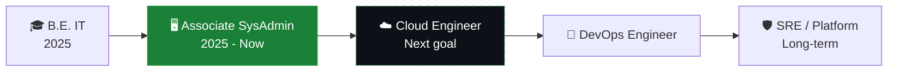

<!-- ========== HEADER ========== -->
<p align="center">
  
</p>

<p align="center">
  
</p>

<p align="center">
  <a href="https://www.linkedin.com/in/vaibhav-mohite-6b10a3280/"></a>
  <a href="mailto:vaibhavmohite195@gmail.com"></a>
  
  
</p>

<!-- ========== TERMINAL INTRO ========== -->
```bash
vaibhav@pune:~$ whoami
Vaibhav Mohite

vaibhav@pune:~$ cat about.txt
Role        : Associate System Administrator (24x7 enterprise environment)
Experience  : 1+ year in infrastructure, endpoint security and backup operations
Education   : B.E. Information Technology, SPPU (2025)
Mission     : Move from keeping systems running to building systems that run themselves
Based in    : Pune, Maharashtra, India

vaibhav@pune:~$ cat now.txt
Building    : DevOps projects with Docker, Git, CI/CD and Terraform
Learning    : AWS, Linux administration, automation, Kubernetes (next)
Looking for : Cloud Engineer / DevOps Engineer / Infrastructure Engineer roles
```

---

## 🗺️ My Journey



I'm building on a real operations foundation: I already know what breaks in production, what a good backup is worth, and why monitoring matters. Now I'm adding the automation and cloud layer on top.

---

## 🛠️ Tech Stack

<p align="center">
  
</p>

<table>
  <tr>
    <td valign="top" width="33%">
      <h4>☁️ Cloud and DevOps</h4>
      AWS, GCP (certified), Docker, Terraform, Git, GitHub Actions, CI/CD concepts
    </td>
    <td valign="top" width="33%">
      <h4>🖥️ Systems and Infrastructure</h4>
      Linux, Windows Server, Active Directory, Hyper-V, SCCM, Microsoft Intune, SQL
    </td>
    <td valign="top" width="33%">
      <h4>🛡️ Backup, Monitoring and Security</h4>
      Veritas Backup Exec, Acronis, Grafana, Microsoft Defender EDR, Trellix DLP, SonicWall
    </td>
  </tr>
</table>

---

## 🧭 Learning Roadmap

| Status | Skill |
|:---:|---|
| ✅ | Cloud fundamentals: Google Cloud, AWS Academy, Oracle Cloud |
| ✅ | Linux fundamentals (Linux Foundation LFS101) |
| ✅ | Terraform and infrastructure as code |
| ✅ | Git and CI/CD pipelines |
| ✅ | AWS hands-on projects |
| 🔄 | Docker and containers |
| ⏳ | Kubernetes |
| ⏳ | AWS Solutions Architect Associate |
| ⏳ | Azure Administrator (AZ-104) |

✅ done &nbsp;·&nbsp; 🔄 in progress &nbsp;·&nbsp; ⏳ up next

---

## 🚀 Featured Projects

<table>
  <tr>
    <td width="50%" valign="top">
      <h4>📦 <a href="https://github.com/Vaibhav321123/vprofile-project1">vprofile-project1</a></h4>
      Multi-tier Java web application set up as a hands-on DevOps project.<br/><br/>
      
      
    </td>
    <td width="50%" valign="top">
      <h4>🔒 Coming soon</h4>
      Terraform on AWS (VPC + EC2 + web app as code)<br/>
      Docker + GitHub Actions auto-build pipeline<br/>
      Grafana monitoring dashboard project
    </td>
  </tr>
</table>

---

## 🏆 Certifications

<p>
  
  
  
  
  
</p>

---

## 💡 How I Work

- 🔧 **Troubleshoot first, guess never.** Find the root cause, then fix it properly.
- ⚙️ **Automate repetitive tasks.** If I do it twice, I script it.
- 📝 **Document what I build,** so the next person (or future me) can follow it.
- 🛡️ **Reliability and security matter** as much as speed.

---

## 🐍 Contribution Snake

<picture>
  <source media="(prefers-color-scheme: dark)" srcset="https://raw.githubusercontent.com/Vaibhav321123/Vaibhav321123/output/github-snake-dark.svg" />
  <source media="(prefers-color-scheme: light)" srcset="https://raw.githubusercontent.com/Vaibhav321123/Vaibhav321123/output/github-snake.svg" />
  
</picture>

<details>
<summary><b>📊 GitHub stats (click to expand)</b></summary>
<br/>
<p align="center">
  
  
</p>
</details>

---

## 📫 Let's Connect

I'm open to conversations with recruiters, engineers and anyone interested in cloud, DevOps and infrastructure. If you have a role, a project idea, or advice for someone moving from sysadmin to DevOps, I'd love to hear from you.

<p align="center">
  <a href="https://www.linkedin.com/in/vaibhav-mohite-6b10a3280/"></a>
  <a href="mailto:vaibhavmohite195@gmail.com"></a>
</p>

<p align="center"><i>"Automate everything you can. Understand everything you automate."</i></p>

<p align="center">
  
</p>
